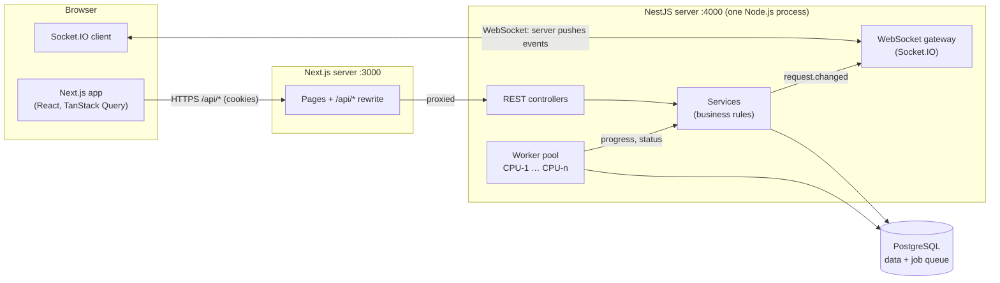
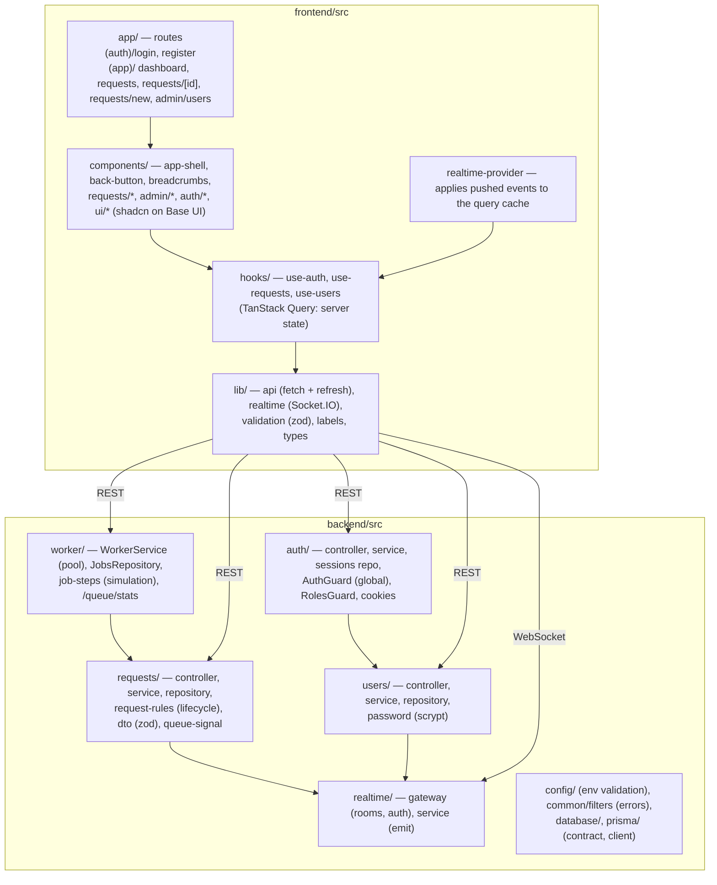
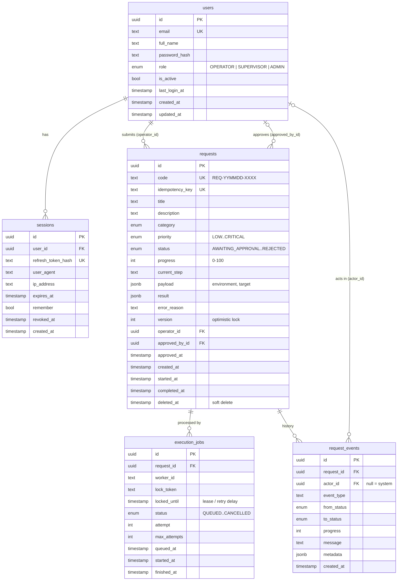
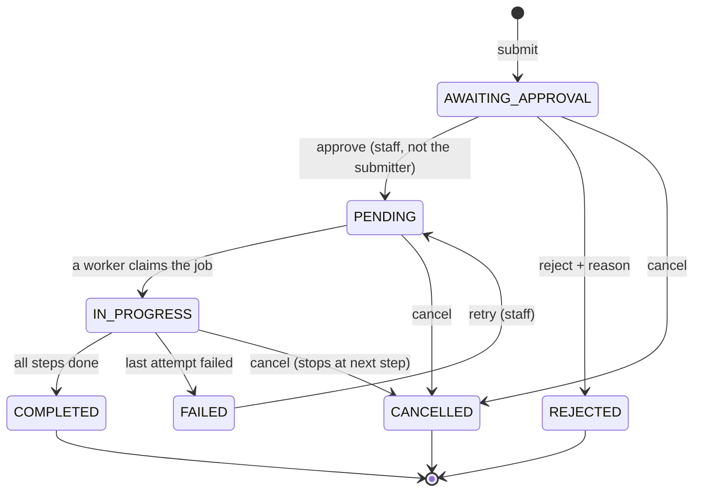
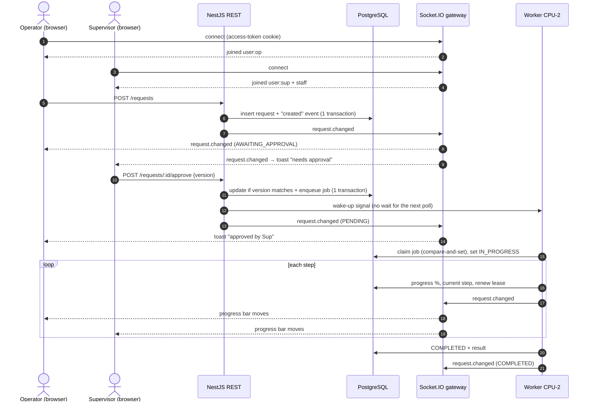
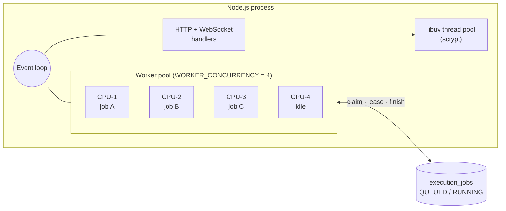

# CloudPulse — System Design

This document covers deliverable 2 of the assignment: the architecture, components, database, REST API, WebSocket flow, concurrency model and the reasons for each technology choice. It builds on the requirements in [ANALYSIS.md](ANALYSIS.md); requirement IDs (FR-x, NFR-x) refer to that document.

Diagrams use Mermaid, which GitHub renders in place.

## 1. High-level architecture



- **One origin for the browser.** The browser calls `/api/*` on the Next.js server, which forwards to NestJS. Cookies are therefore first-party and no CORS setup is needed for REST.
- **WebSockets go straight to the API.** Next.js rewrites can't carry a WebSocket upgrade, so the Socket.IO client connects to the API port directly. Only `FRONTEND_ORIGIN` is allowed to connect, and the access-token cookie authenticates the handshake.
- **Writes go only through REST; events go only through WebSockets.** Every change is validated and authorized in one place (REST → service), then broadcast. The socket is push-only, so it can't be used to bypass the rules.
- **The worker pool runs inside the API process** as asynchronous tasks (see §6). PostgreSQL is both the data store and the job queue, so a request change and its job are written in the same transaction.

## 2. Component diagram



### Backend layers

| Layer | Responsibility | Knows about |
|---|---|---|
| **Controller** | Route, status code, request validation (zod via `StandardSchemaValidationPipe`), `@Roles` | HTTP |
| **Service** | Business rules: lifecycle, four-eyes rule, optimistic locking, who sees what, emitting events | Neither HTTP nor SQL |
| **Repository** | Queries and transactions through the Prisma ORM; one place per table | SQL |
| **Cross-cutting** | `AuthGuard` (every route needs a login unless `@Public`), `RolesGuard` (role read from the database each time), `AllExceptionsFilter` (one error shape, no leaked internals), `ConfigModule` (validated env) | — |

The lifecycle rules (allowed status changes) live in one file, [`request-rules.ts`](../backend/src/requests/request-rules.ts), used by both validation and services.

### Frontend state

- **Server state** (requests, users, the signed-in user) lives in the **TanStack Query** cache. Hooks in `hooks/` wrap each endpoint.
- **Live updates** go into that same cache: `realtime-provider` writes the pushed request into the detail cache and marks lists and stats as stale. Components re-render with no extra code.
- **UI state** (filters, page) lives in the **URL query string**, so Back, refresh and shared links keep the view. Forms use **react-hook-form + zod**.

## 3. Database design

PostgreSQL, schema defined in [`contract.prisma`](../backend/src/prisma/contract.prisma) and applied through versioned migrations in `backend/migrations/`.



### Design decisions

| Decision | Reason |
|---|---|
| **UUID v7** primary keys | Unique without a central counter and roughly time-ordered, so indexes stay compact |
| Separate **`execution_jobs`** table | One request can have several attempts (retries); each keeps its own lease, worker and timing. The request holds the business state, the job the processing state. |
| Append-only **`request_events`** | The timeline and the audit trail (NFR-8). Rows are only ever inserted. |
| **`version`** column | Optimistic locking: every update is `WHERE id = ? AND version = ?`, and a stale write gets 409 (FR-18) |
| Refresh tokens stored as **SHA-256 hashes** | A database leak doesn't give away sessions |
| **Foreign-key actions** | Deleting a user is restricted while they own requests; approver and actor become NULL; jobs and events cascade with their request |

### Constraints and indexes

- **CHECK constraints:** progress between 0 and 100 (requests, jobs, events); `version ≥ 1`; `attempt ≥ 1`.
- **Unique:** `users.email`, `requests.code`, `requests.idempotency_key`, `sessions.refresh_token_hash`.
- **`jobs_one_active_per_request`:** a unique partial index on `request_id WHERE status IN ('QUEUED','RUNNING')`. The database itself guarantees that a request never has two active jobs (NFR-4).
- **Partial indexes** for the hot queries, all `WHERE deleted_at IS NULL`: the queue (`status, priority, created_at`), per-operator lists, category/status, in-flight requests, and job claiming (`status, queued_at`). A GIN index on `payload` supports JSON search.

## 4. REST API design

**Conventions**

- JSON bodies; nouns for resources; actions that aren't plain updates are sub-resources (`POST /requests/:id/approve`).
- **Auth:** httpOnly cookies set at login (browsers), or `Authorization: Bearer <accessToken>` (API clients). Every route needs a login unless marked public.
- **Validation:** zod schemas; unknown fields are rejected (`strictObject`).
- **Errors** always look like this:

  ```json
  { "statusCode": 409, "error": "Conflict", "message": "This request was changed since you loaded it…", "path": "/requests/…/approve", "timestamp": "2026-11-20T10:00:00.000Z" }
  ```

  Validation errors put one message per field in `message[]`.
- **Status codes:** 400 invalid input · 401 not logged in · 403 not allowed · 404 missing or not yours (hidden from operators, so IDs can't be probed) · 409 conflict (stale version, wrong state, duplicate) · 500 generic.
- **Lists** return `{ items, total, limit, offset }`.

The endpoint reference with request and response details is in the [README](../README.md#api-reference).

### Request lifecycle



Retries inside one run (attempt 1 → 2 → 3) keep the request IN_PROGRESS and add events; only the final failure moves it to FAILED.

## 5. WebSocket communication

**Transport:** Socket.IO over WebSocket, on the API port.

**Authentication:** the handshake carries the same JWT access token as REST (cookie, or `auth.token`). Missing or invalid tokens are refused with `connect_error: "unauthorized"`. The server disconnects a socket when its token expires; the client refreshes the token and reconnects.

**Rooms:**

| Room | Members | Receives |
|---|---|---|
| `user:<id>` | Every socket of one user (all tabs and devices) | Changes to their own requests; session notices |
| `staff` | Every supervisor and admin | Changes to every request |

**Events (server → client):**

| Event | Payload | Sent to | Sent when |
|---|---|---|---|
| `request.changed` | `{ request, event }`: the full request row and the timeline event that changed it | `staff` + `user:<submitter>` | Any change: created, approved, rejected, picked up, progress, completed, failed, cancelled, retried, priority or note |
| `session.changed` | none | `user:<id>` | That user's role changed. Their sockets are then disconnected, so they reconnect with a new token and join or leave `staff`. |

There are no client → server events: writes go through REST.



**Client handling** ([`realtime-provider.tsx`](../frontend/src/components/realtime-provider.tsx)):

- The pushed request is written into the detail cache when it is newer (by `version`), so the page updates with no request to the server.
- Lists and stats are marked stale and refetch once, so filters, sorting and counts stay correct.
- After every (re)connect, the client refetches everything once to catch up on anything missed while offline.
- A Live, Connecting or Reconnecting indicator shows the connection state.

The only timer in the client is a 15-second refresh when a "submitted in the last…" filter is on, so requests that age out of the window disappear. That handles passing time, not data changes, which are still pushed.

## 6. Concurrency model

Node.js runs JavaScript on one thread with an event loop. Request processing is **I/O-bound** (in production, waiting on cloud APIs; here, simulated with timers), so the right tool is **asynchronous tasks**, not OS threads. While a job waits, the event loop serves HTTP requests, WebSocket traffic and the other jobs, so long-running work never blocks the API (NFR-1). The one CPU-heavy operation, password hashing (scrypt), runs on libuv's thread pool.



**How a slot runs a job** ([`worker.service.ts`](../backend/src/worker/worker.service.ts)):

1. **Fill.** When a slot is free, the pool claims the next job: highest priority, then oldest. It wakes immediately on a queue signal (approve or retry), and otherwise polls the database every `WORKER_POLL_MS` as a fallback.
2. **Claim.** `UPDATE execution_jobs SET status='RUNNING', lock_token=?, locked_until=now()+lease WHERE id=? AND status='QUEUED'`. When several workers race, exactly one update succeeds; the others try the next candidate.
3. **Run the steps.** Each step waits, then updates progress and the current step, renews the lease (heartbeat) and pushes an event. Every write includes the lock token, so a worker that lost the job (lease expired, request cancelled) notices and stops.
4. **Finish.** On success the job becomes SUCCEEDED and the request COMPLETED. On failure the job becomes FAILED and a new attempt is queued with exponential backoff (2 s, 4 s, 8 s …, max 60 s), or the request becomes FAILED after `WORKER_MAX_ATTEMPTS`.
5. **Cancel.** Cancelling cancels the queued job in the same transaction; a running job sees the cancelled status at its next step and stops.

**Safety guarantees (NFR-4, NFR-5)**

| Risk | Guard |
|---|---|
| Two workers take the same job | Compare-and-set claim, plus the unique index allowing one active job per request |
| A worker crashes mid-job | Its lease expires; a reaper takes the job over (also by compare-and-set) and retries it |
| The server restarts | Graceful shutdown aborts the slots and hands their jobs back to the queue. On startup, approved requests without a job are re-queued. |
| A worker and a person change a request at once | Every change is conditional on the request's version or status; the loser gets a conflict and rereads |
| Bulk approval collides with a single approval | Each request in the bulk is approved with its own version check; collisions are counted as "changed meanwhile" and skipped |

Because all coordination goes through PostgreSQL, **several API instances can share one queue** without processing anything twice.

## 7. Security design

- **Passwords:** scrypt (N=2¹⁷, r=8, p=1, OWASP-recommended), constant-time compare. Unknown emails are checked against a dummy hash, so response time doesn't reveal which emails exist.
- **Tokens:** a short-lived JWT access token (HS256, 10 min, with issuer and audience checked) plus a long-lived random refresh token. The refresh token rotates on every use (each works once) and is stored only as a hash.
- **Cookies:** httpOnly (scripts can't read them), SameSite=Lax (other sites can't send them on POST), Secure in production. Multi-account support keeps one refresh cookie per saved account.
- **Authorization:** `RolesGuard` reads the user's current role from the database on each request, so a demotion takes effect at once. Operators get 404 for other users' requests. Staff can't approve or reject their own requests.
- **Input:** strict zod schemas on every body and query; LIKE patterns are escaped.
- **Errors:** unexpected errors are logged with their stack but answered with a generic 500.
- **WebSockets:** origin check, token authentication, disconnect at token expiry, push-only.

## 8. Technology stack and justification

| Area | Choice | Why this over alternatives |
|---|---|---|
| Language | **TypeScript** (both sides) | One language end to end. Types are shared in spirit across the API, ORM and UI, and the compiler catches contract drift. |
| Backend framework | **NestJS 12** | Modules, dependency injection, guards, pipes and filters give the required layered architecture out of the box. First-party WebSocket and config packages. More structure than bare Express or Fastify for a multi-module app. |
| Real-time | **Socket.IO** (`@nestjs/websockets`) | WebSocket with automatic reconnect and backoff, rooms for "who sees what", and auth middleware. Raw `ws` would mean rebuilding all of these. |
| Concurrency | **Async worker pool in-process + PostgreSQL queue** | Processing is I/O-bound, so async tasks on the event loop are the idiomatic Node.js answer. Worker threads only help CPU-bound work. A database queue avoids running Redis or RabbitMQ while staying safe for several instances (compare-and-set, leases). Swapping in BullMQ later only touches `worker/`. |
| Database | **PostgreSQL 18** | Relational data with real relationships and constraints (FK, CHECK, partial unique indexes), transactions for "change + event + job" atomically, JSONB for payloads. |
| ORM | **Prisma ORM (Postgres)** | Typed queries generated from one schema contract, versioned migrations, transactions. |
| Validation | **zod 4** | One schema library on both sides; the Standard Schema pipe in NestJS validates bodies and queries without classes. |
| Frontend | **Next.js 16 + React 19** | File-based routing, layouts, a server-side rewrite for one-origin cookies, and the React Compiler. |
| Server state | **TanStack Query** | Caching, deduplication, refetch-on-focus and placeholders. Pushed WebSocket events update the same cache, so there is one source of truth. |
| Forms | **react-hook-form + zod** | Fast uncontrolled forms with the same validation messages style as the API. |
| UI | **Tailwind CSS + shadcn/ui on Base UI**, lucide icons, sonner toasts | Accessible primitives, a consistent design system, responsive utilities and dark mode. |
| Tests / quality | **Vitest**, oxlint, ESLint, Prettier | Fast ESM-native tests (104 backend unit tests); type-aware linting. |
| Containers | **Docker + Docker Compose** | `docker compose up --build` runs the whole stack (database, migrations, API, web) the same way everywhere; multi-stage images run as a non-root user. |
| CI | **GitHub Actions** | Every push and pull request is linted, typechecked, tested and built, including both Docker images, so `main` always builds. |

**Scaling path.** Run several API instances behind a load balancer (the API is stateless thanks to JWT, and the queue is already multi-worker safe). Add the Socket.IO Redis adapter so an event emitted on one instance reaches sockets on the others. Move workers to their own process with `WORKER_ENABLED=false` on the API instances.
